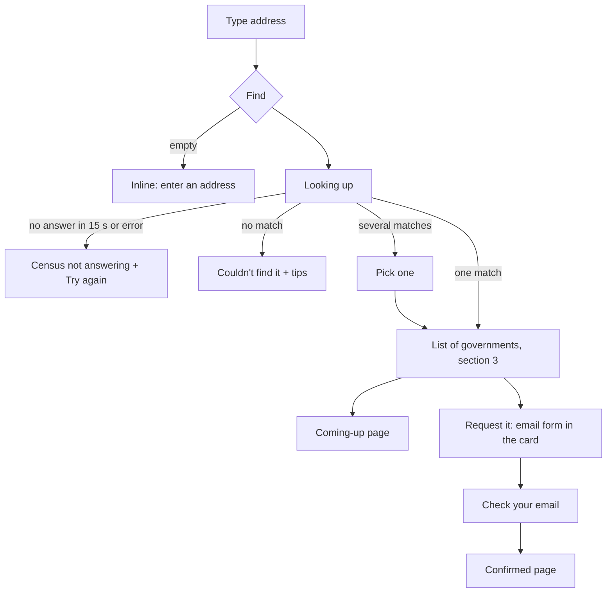

# Design: daylight-national (Daylight Digest, the national website)

Status: draft v1, 2026-11-19. Owner: ux-designer. Spec: `docs/specs/daylight-national.md` (v2.1: request by email
is the main path; weekly email and feeds are both M4). Panel input:
`docs/research/focus-group-daylight-national.md` (Recommended changes). Website only; no app.
Every quoted string below is a fixed label and goes in the label file (AC4.8). Copy rules: plain words, US English,
no em-dashes, no AI text, nothing about a named official. Dates print as "May 11, 2026" (existing `day_words`).
Names, dates and agenda text inside the wireframes are made-up samples that show layout only; never ship them.
User-facing copy says "government" (the city, county, township or school district) and the board's own name; it
never says "body" (focus group: jargon). See proposed spec change P1.

## 0. Shared frame (all Digest pages)

**Reused, unchanged:** tokens in `site/static/style.css` (navy `--blue`/`--link` #0F1F3D, orange `--sun`/`--focus`
#D2561B for rings and dots only, `--seal` for any orange text, `--bg` paper, `--muted`, radii 6/12/18, type scale
`--t-*`, Outfit heads, Inter body, JetBrains Mono eyebrow labels), dark-mode tokens, header pane
(`_header.html.j2`), Menu drawer (`<dialog>`), "Independent, unofficial" tag, footer, `.crumb`, content card,
`<details>` toggles, 44px touch rows, the address form pattern and `#addr-result` (`role="status"`), the
morning-note card (`.mn-card`), "Report an error".

**Decisions for the frame (assumptions, for architect and frontend to confirm):**
- D1. Header is the same markup. On Digest pages the name plate reads "Daylight Digest" with the place line
  "United States". The date line prints the date with no place ("Thursday, November 19"). The sky uses the
  existing no-`sky_place` behavior (clock sun, no moon), because Clarksville's sky is wrong for a reader in Oregon.
  Needs a rule in site check `header/same-on-every-page` for the plate and date words.
- D2. The "Show records from" switch is not shown on Digest pages (it lists Clarksville bodies only). Needs an
  exemption in site check `switch/on-every-page`.
- D3. Menu drawer gains one group, "Daylight Digest": "Find your local governments", "What we cover". Clarksville's
  front page gets one underlined line under its address card: "Not in Clarksville? Find your local governments
  anywhere in the US." (AC8.2). Nothing else on existing pages changes (US8).
- D4. Suggested pages (architect names the paths): entry `digest/`, list `digest/covered.html`, coming-up
  `digest/<state>/<body-id>.html`, request confirmed `digest/requested.html`, letter `digest/letter.html` (M3),
  sign-up `digest/signup.html` (M4).
  The result of a lookup is drawn on the entry page itself; the URL and `<title>` never change (AC1.3).

**Status pill (new, one component, three variants).** Words carry the meaning; shape backs it up; no red or
green, so no status reads as a grade (R2).

| Status | Look | Contrast |
|---|---|---|
| Covered | filled navy pill, white text, check mark | white on navy about 16:1 |
| Not covered yet | outlined navy pill, navy text, hollow circle | navy on paper about 15:1 |
| Can't cover | dashed-outline pill, navy text, slashed circle | same |

Icons are `aria-hidden`; the pill text is real text. In dark mode the pill uses `--blue`/`--on-blue` and `--link`.

**Accessibility baseline (every screen, AC0.1, WCAG 2.2 AA).**
- One `h1` per page; sections are real `h2`/`h3`; lists are real lists; agenda text is page text, never an image.
- Sizes in `rem`, no fixed heights, nothing clipped. At 200% text size and at 320 CSS px wide: buttons wrap to
  full width, a pill drops under its name, the input and Find stack. No sideways scroll.
- Focus ring: existing 3px `--focus` with 2px offset (about 4:1 on paper). Focus order equals reading order. No
  sticky bars, so focus is never covered (2.4.11). Every control is at least 44px tall on touch.
- Links are underlined at rest (navy sits close to ink). Body text `--fg` on `--bg`; small text `--muted`
  (about 7:1). Nothing smaller than `--t-xs` for sentences.
- Changes without a page load are announced through one `role="status"` region per card or form. Errors are text
  next to the field, joined by `aria-describedby`, never color alone.
- No animation needed anywhere; a spinner is text ("Looking up...") only.

## 1. Entry page (M1): US1, US9, AC1.9, AC1.10

**Purpose.** Let a person decide in ten seconds whether to trust the box, then type an address or go browse.

**Content, in priority order.**
1. `h1` and one lede sentence.
2. Who runs it and who pays (AC1.9), two sentences at most, with a link to About.
3. Link to "What we cover" (AC1.10), above the box.
4. Address card: label, input, Find, the plain privacy sentence directly under the input (AC9.1, AC1.1).
5. Census detail, the Census notice (AC1.7), and a closed "How this works, and what is saved" toggle.
6. Saved list from the last lookup on this device, if any (section 3 layout).

Layout rule: at 360x640 the `h1`, the who-runs-it line, the cover link, the input and Find are on the first screen
(same idea as `tests/test_address_box.py`). If Brian's approved who-runs-it wording runs past 170 characters, its
second sentence moves behind the "Who runs this" link.

```
+------------------------------------+
| [=] Menu   DAYLIGHT DIGEST     (o) |
| Independent, unofficial  Thu Nov 19|
+------------------------------------+
| Find your local governments        |  h1
| See every local government for     |
| your address, and what we cover.   |
|                                    |
| Run and paid for by gnoshcodes LLC,|
| a small software company in        |
| Clarksville, Tennessee. No ads and |
| no political money. Who runs this  |
|                                    |
| See what we cover first >          |
| +--------------------------------+ |
| | Your street address            | |
| | [ 100 Main St, City, State   ] | |
| | [          Find              ] | |
| | We never get your address and  | |
| | never sell anything.           | |
| +--------------------------------+ |
| Your address goes from your        |
| browser straight to the US Census  |
| Bureau ... Census privacy policy   |
| > How this works, and what is saved|
| This product uses the Census ...   |
+------------------------------------+
```

**Copy.**

| Element | Copy |
|---|---|
| `<title>` | Find your local governments - Daylight Digest |
| h1 | Find your local governments |
| Lede | See every local government for your address: city or town, county, township and school district. We show what we cover and say plainly what we don't. |
| Who runs it (DRAFT, Brian approves the facts) | Daylight Digest is run and paid for by gnoshcodes LLC, a small software company in Clarksville, Tennessee. It takes no ads and no political money. [Who runs this] |
| Cover link | See what we cover first, without typing anything |
| Input label | Your street address |
| Placeholder (hint only; the label stays visible) | 100 Main St, City, State |
| Button | Find |
| Privacy, plain | We never get your address and never sell anything. |
| Privacy, detail | Your address goes from your browser straight to the US Census Bureau, which finds your area. Daylight Digest never sees or keeps it. [Census privacy policy] |
| Toggle summary | How this works, and what is saved |
| Toggle body | The Census Bureau answers with the names of the city or town, county, township and school districts for that spot. Only that list of governments is kept, and only on this device, so you don't have to look it up again. You can check this yourself: open your browser's network tools and look up an address. The only request that carries it goes to geocoding.geo.census.gov. |
| Census notice (word for word) | This product uses the Census Bureau Data API but is not endorsed or certified by the Census Bureau. |
| No script | The address lookup needs JavaScript. You can still browse [What we cover]. |

"Who runs this" links to the About page's operator section, which already names the person who runs the LLC from
the data (`operator_person`). See open question Q1 (resolved: no extra sentence).

**States.** Empty: as drawn. Loading and errors: section 2. No script: the form is hidden and the no-script line
shows (existing behavior). Returning visitor with a saved list: the list shows under the card with the heading
"Your saved list" and a "Forget this list" button.

**Accessibility.** Focus order: skip link, Menu, name plate, date, Who runs this, cover link, input, Find, Census
privacy link, toggle, notice. The input has a visible `<label>`, `autocomplete="street-address"`, and
`aria-describedby` pointing at the plain privacy sentence. No third-party autocomplete (it would send keystrokes).

**M1 vs later.** All of this is M1.

## 2. Address lookup flow (M1): US1, AC2.5, AC2.7, AC2.10 to AC2.12



All messages render in `#addr-result` (`role="status"`) inside the card, directly under the input.

| State | What the person sees | Notes |
|---|---|---|
| Typing | Nothing changes. No live checks, no suggestions. | Find is always enabled. |
| Empty submit | "Type a street address with its city and state." | Focus stays in the input. Nothing is sent. |
| Looking up | Button reads "Looking up..." and is `aria-disabled`; status: "Looking up the address with the Census Bureau..." After 6 seconds add: "Still looking. The Census service can be slow." | Input stays editable; a second submit is ignored. |
| Census down (15 s or error) | "The Census lookup is not answering. We can't find your area without it, and we won't guess. Try again in a few minutes." [Try again] and "Or browse [What we cover]." | AC1.6. Try again resends the text still in the box. Focus moves to Try again. |
| Not found | "We couldn't find that address." Tip: "Check the spelling, add the city, state and ZIP, and leave off the apartment number. The Census does not know PO boxes." | AC1.4. Focus returns to the input, text kept for editing. |
| More than one match | `h2` "Which one is yours?" then one full-width button per match showing the Census's matched address text, and "None of these" (returns to the input). | AC1.5. Focus moves to the `h2`. Max 20; above that show Not found tips. |
| Found | Section 3 list. Line above it: "Census matched: 1 PUBLIC SQ, CLARKSVILLE, TN, 37040" (page text only, never saved; lets the person catch a wrong match). | Focus moves to the list `h2` (`tabindex="-1"`). |
| Unincorporated | List shows no city or town card. Line in that slot: "This address is not inside a city or town." | AC2.5. |
| New England town (or NY town, township state) | The town or township card shows in its fixed slot. If no county government exists: "No county is listed here because the county is not a working government." | AC2.10, AC2.11. One fixed sentence for every state. |
| Consolidated city-county, independent city | One card. Line under the list head: "The city and county here are one government." (consolidated) or "This city is not part of any county." (independent city) | AC2.7. |
| Nothing covered (most of the US in M1) | Summary line: "We found 3 local governments. None are covered yet. Request the ones you want and we'll email you if one opens." Cards follow as usual. | Never a blank page; each card still gives the official link when we have it. |
| Nothing listable returned | "The Census found this address, but we can't list a local government for it yet." plus the AC2.9 line and the election office link. | Covers AC2.12 units of unknown status. |

**Accessibility.** After each result, exactly one focus move (to the result heading, the input or Try again).
Status text is also visible text, never only announced. Timeouts never clear what was typed.

## 3. The list for this spot (M1): US2, US5, AC8.3

**Purpose.** One honest list. Each government gets the same card, the same fields and a fixed place (R2, AC2.3).

**Content, in priority order.**
1. `h2` "Local governments for this address", the "Census matched" line, and the summary count line.
2. Cards in fixed order: city or town, county, township or town, school districts (elementary, secondary, unified).
3. Under the list: the line about bodies an address can't find (AC2.9), the election office line, "Forget this
   list", and "Look up another address".

Card fields, same order every time: slot label (mono eyebrow), name as the Census gives it (`h3`), board name
from our directory when we have one, status pill, then the actions for that status.

```
+------------------------------------+
| Local governments for this address |  h2
| Census matched: 1 PUBLIC SQ, ...   |
| We found 3. 2 covered, 1 we can't  |
| cover.                             |
| +--------------------------------+ |
| | CITY OR TOWN                   | |
| | Clarksville city               | |  h3
| | Clarksville City Council       | |
| | [v Covered]                    | |
| | See what's coming up >         | |
| | Full Daylight pages >          | |
| +--------------------------------+ |
| | COUNTY                         | |
| | Montgomery County  [v Covered] | |
| +--------------------------------+ |
| | SCHOOL DISTRICT                | |
| | Clarksville-Montgomery County  | |
| | School District                | |
| | [/ Can't cover]                | |
| | Its records site blocks        | |
| | automated readers. Checked     | |
| | November 7, 2026. Source       | |
| | Official agenda page >         | |
| | [        Request it          ] | |
| | We'll email you if it opens.   | |
| +--------------------------------+ |
| Some governments, such as water or |
| transit boards, can't be found by  |
| address yet.                       |
+------------------------------------+
```

**Copy.**

| Element | Copy |
|---|---|
| Slot labels | CITY OR TOWN / COUNTY / TOWNSHIP OR TOWN / SCHOOL DISTRICT |
| Summary | We found {n} local governments. {a} covered, {b} not covered yet, {c} we can't cover. (zero parts are left out) |
| Covered, main link | See what's coming up |
| Covered, Clarksville and Montgomery County only (AC8.3) | Full Daylight pages (votes and past meetings) |
| Covered, same two, while the morning note is live (A12) | Get the morning note |
| Not covered yet, line | We don't read this government's agendas yet. |
| Official link, both uncovered statuses | Official agenda page (opens the government's own site) |
| No official link in the directory (Not covered yet only) | We don't have a link to its official agenda page yet. |
| Can't cover reasons (one per card, from the directory) | Its records site blocks automated readers. / Its agendas are posted only as scanned images. / It does not post its agendas online. / Its agenda system's public data feed is turned off. / Its agenda system's data feed needs a key we don't have. |
| Can't cover, proof line | Checked {date}. [Source] |
| Button, and the hint under it | Request it / We'll email you if it opens. |
| Under the list (AC2.9) | Some governments, such as water or transit boards, can't be found by address yet. |
| Election office line | Not sure this list is right? Your local election office has the official answer. [Find it] |
| Device line | This list is kept on this device only. [Forget this list] |

**"Request it" (US5, spec v2.1): the main path is "Email me when it opens".** Tapping "Request it" opens a short
form inside that card (no new page, so the list and the person's place in it stay). It asks for an email only,
then double opt-in (AC5.1). One form can carry several governments, so a person with four uncovered governments
types the email once and gets one confirmation email.

```
| | [ Request it                 ] | |   tap
| | -------------------------------| |
| | Email me when it opens         | |  h4, focus lands here
| | We'll email you once if we open| |
| | it. We may never reach it, and | |
| | we promise no date.            | |
| | Your email                     | |
| | [ you@example.com            ] | |
| | Also request (optional)        | |
| | [ ] Marion County              | |
| | [ ] Salem-Keizer School Dist.  | |
| | We keep only your email and    | |
| | the governments you request... | |
| | [ Send me the confirmation   ] | |
| | [ email                      ] | |
| | Cancel                         | |
| | No email? Just count me.       | |   only if the counter is built
```

| State | What the card shows |
|---|---|
| Ready | Button "Request it" (outlined navy, full width on a phone). |
| Form open | Heading "Email me when it opens"; honest line; "Your email"; "Also request (optional)" tick boxes for the other Not covered yet and Can't cover governments in this list, unticked by default so every request is a real choice (R8 reads these counts); privacy line; button "Send me the confirmation email"; "Cancel". |
| Sending | Button reads "Sending..." (`aria-disabled`). |
| Sent, waiting for the person to confirm | Form replaced by, with a check mark: "Check your email and tap the link in it to confirm. Your request counts only after you confirm." Every government ticked in the form flips to this state. "Use a different email" reopens the form. |
| Failed | Form stays, text kept: "We couldn't reach our email service. Nothing was saved. Try again in a few minutes." |
| Bad email | Next to the field: "That doesn't look like an email address." |
| Returning to the page | "Request sent from this device. If you haven't confirmed, check your email." [Request again] (the device keeps the government's ID only, never the email). |

| Element | Copy |
|---|---|
| Honest line, Not covered yet | We'll email you once if we open it. We add a government only after real requests, one at a time. We may never reach this one, and we promise no date. |
| Honest line, Can't cover (proposed spec change P2) | We can't cover this government unless the way it posts its records changes. If that happens and we open it, we'll email you once. Your request also tells us people want it. |
| Privacy (AC9.2, AC5.3) | We keep only your email and the governments you request. We never get your address. You get one email to confirm now and one if a government opens, nothing else. Your email is held by Buttondown, our email service. [Buttondown's privacy policy] |
| After the person taps the link in the email (AC5.2; a plain page, `digest/requested.html`, or the confirmation email itself if the provider can't send people back to us) | Thanks. Your request is confirmed. We'll email you once if we open it. We add a government only after real requests, one at a time, and we may never reach yours. [Back to Daylight Digest] |
| Optional counter (AC5.6, only if the architect builds it) | Link-style button: "No email? Just count me." Done: "Counted, with nothing about you. We won't be able to tell you if it opens." Failed: "We couldn't count that. Try again." |

Rules: the success text is the same whether or not that email already asked (the page never reveals who is on a
list). A repeat request adds no second count (AC5.5). No count is shown to the public (AC5.4). The email is never
written to storage; inside one page view the form remembers it in memory so a second card's form is prefilled.
The form follows the morning-note form's way of posting to Buttondown (architect confirms it can stay on the page
and send several tags for an address that is already confirmed; if it can't, the fallback is one request per form).

**States.** Empty and error cases are the rows in section 2. A card whose directory entry is missing renders as
Not covered yet (AC2.8), never blank.

**Accessibility.** Each card is a list item whose `h3` names it; the pill follows the name in the reading order so
a screen reader hears "Clarksville city, Clarksville City Council, Covered". Focus order inside a card: main link
or official link, then Request it. "Request it" is a button with `aria-expanded` and an accessible name that
includes the government ("Request it: Marion County"). Opening the form moves focus to its heading; the email
input is `type="email"`, `autocomplete="email"`, with a visible label; the tick boxes sit in a `<fieldset>` with
the legend "Also request (optional)". Sent and failed messages are announced through the card's `role="status"`
line and focus moves to the message. "Cancel" closes the form and returns focus to "Request it".

**M1 vs later.** M1: all of it, including the request form and the confirmed page (M1 is done when Brian requests a
government with a team address, confirms, and sees it in the internal report). The optional counter: only if the
architect builds it. M3 adds the letter link ("Ask them to post readable records") on eligible Can't cover cards
only (section 7).

## 4. What we cover (M1): US12

**Purpose.** Show coverage with nothing asked, for the person who will not type an address (focus group 5/5).

**Content, in priority order.**
1. `h1`, the count sentence, and the share sentence once it has been computed (AC12.2).
2. One line on how a government gets added (AC12.3).
3. Link to the address lookup.
4. Covered list: `h2` per state (A to Z), governments by name, each linking to its coming-up page.
5. "Can't cover" list: same grouping; reason, checked date, official agenda link.
6. One closing line about everything else.

Layout at 360px: one column of ruled rows (the existing ruled list). A Covered row is the board name as a link with
its slot ("City or town") on the line under it. A Can't cover row is the name, then the reason and checked date,
then the official agenda link, each on its own line.

**Copy.**

| Element | Copy |
|---|---|
| h1 | What we cover |
| Count | Daylight Digest covers {n} local governments today. |
| Share (only once computed; shown however small) | About {x}% of US addresses have at least one covered government. We estimated this from {k} random addresses on {date}. [How we counted] |
| How one is added | We add a government only after people request it and our owner approves the new source. We add them one at a time and promise no dates. |
| Lookup link | Find the governments for your address |
| Section heads | Covered / Can't cover |
| Row link (accessible name includes the government) | Coming up |
| Closing line | Every other local government in the US is not covered yet. Look up your address to request yours. |
| Empty "Can't cover" | None right now. |

**States.** Static page: no loading or error state. No address, email, account, cookie or storage (AC12.1).
Growth: past about 30 rows add a jump list of states (the About page's pattern: ruled list wide, one closed
toggle on a phone); past about 100 add an on-page name filter that makes no network call.

**Accessibility.** Covered and Can't cover are `h2`; states are `h3`; rows are list items. Row links read
"Clarksville City Council, coming up", not a bare "Coming up".

**M1 vs later.** M1: the page with the real two covered and one can't-cover rows. The share sentence appears when
the offline estimate exists. Jump list and filter: when the row counts above are reached.

## 5. Coming-up page for a covered government (M1): US4, AC8.3; feeds US11 (M4)

**Purpose.** What this board will take up next, in its own words, each meeting one tap from the official document.

**Content, in priority order (identical on every page, AC4.9).**
1. Crumb, eyebrow (state and slot), `h1` (board name), "Coming up" as the page's subject line.
2. "Unofficial copy. Official record:" line with the link to the government's own meetings page (existing rule).
3. Last-checked line; the stale notice replaces it when it applies (AC4.6).
4. Meetings from today on, soonest first. Each meeting: date and time (`h2`), meeting name as posted, time zone
   label, official agenda link, then its items or one of the fixed notices.
5. Each item: number as posted, item title verbatim, topic label when the word list matches (AC4.7), and the rest
   of the item's text verbatim.
6. Follow block (M1: morning note and full Daylight links for the two Tennessee bodies; M4: email, calendar, RSS).
7. "Report an error", then the footer.

```
+------------------------------------+
| Daylight Digest / What we cover    |
| TENNESSEE . CITY OR TOWN           |
| Clarksville City Council           |  h1
| Coming up                          |
| Unofficial copy. Official record:  |
| clarksvilletn.gov meetings >       |
| Last checked November 19, 2026.    |
|                                    |
| Thursday, December 3, 2026, 6 PM   |  h2
| Regular Session (as posted)        |
| Central Time. Official agenda >    |
|  1. ORDINANCE 41-2026-27 (first    |  h3, verbatim
|     reading) Amending the zoning.. |
|     [Zoning and land use]          |
|     > Full text of this item       |
|  2. RESOLUTION 22-2026-27 ...      |
|                                    |
| Tuesday, December 8, 2026, 4:30 PM |
| Executive Session (as posted)      |
| Agenda not posted yet.             |
| Official meetings page >           |
|                                    |
| Report an error on this page       |
+------------------------------------+
```

**Copy (fixed labels; everything else on the page is source text).**

| Element | Copy |
|---|---|
| Subject line under h1 | Coming up |
| Unofficial line (existing) | Unofficial copy. Official record: [the government's meetings page] |
| Last checked | Last checked {date}. |
| Stale, more than 3 days (AC4.6) | We last checked this government's site on {date}, {n} days ago. Newer meetings or agendas may be missing. [Official meetings page] |
| Stale, more than 7 days | We couldn't check this government this week. [Official meetings page] |
| Time zone | {Central Time}, as the government posts it. |
| Agenda link | Official agenda |
| No or draft agenda (AC4.3) | Agenda not posted yet. [Official meetings page] |
| Incomplete (AC4.4) | This list may be incomplete. The official agenda is the full record. [Official agenda] |
| Long item toggle | Full text of this item |
| Topic labels | Zoning and land use / Budget and taxes / Contracts and purchases / Appointments |
| Topic note, once per page | Topic labels come from a fixed word list, not AI. [How topics are picked] |
| No meetings | No upcoming meetings are posted. [Official meetings page] |
| Tennessee bodies only (AC4.5) | Votes and past meetings are on the [full Daylight pages]. |
| Follow, M1, Tennessee bodies while the note is live | Get the morning note |

**Item layout rule.** The item title is always shown in full. If the source has more text for the item, text up to
300 characters shows under the title; longer text sits in a native `<details>` ("Full text of this item"), whole
and unedited, so it is still page text (AC0.1, AC4.2). Nothing is shortened, reworded or reordered. The topic
label is a small outlined mono chip after the title; it is text, and its accessible name is "Topic: Zoning and
land use". No votes, outcomes or attendance appear for any body outside the two Tennessee ones (AC4.5).

**Follow block, M4 (US11 and US7, both built in M4).** `h2` "Follow this government": "Get it by email once a week" (to section 6,
with this government ticked), "Add its meetings to my calendar" (calendar feed), "RSS feed, for a news reader app
(also called a feed reader)" with a "Copy feed link" button ("Copied" in a status line), and the line "These links
do not track you." (AC11.3). The JSON feed (AC4.11) is linked from the Method page, not from this block.

**States.** Static page: no loading state. Empty: the "No upcoming meetings are posted." line with the last-checked
line still above it, so silence never looks like a fault. Error: the two stale notices; they sit above the first
meeting in a bordered note with a 4px navy left rule (not orange, not red).

**Accessibility.** Heading outline: `h1` board, `h2` each meeting (date first, so the headings list reads as a
calendar), `h3` each item. Dates use `<time datetime>`. Official links name their target ("Official agenda,
December 3 meeting"). Source text in capitals is left as the source prints it; no CSS case change either way.
At 200% text the item number sits above the title instead of beside it.

**M1 vs later.** M1: all of it for Clarksville City Council and Montgomery County Commission except the M4 Follow
block. M2: the same template for Salem. After M1: test real Legistar titles with people (spec risk).

## 6. Choose governments and topics (M4): US3, AC9.2

**Purpose.** One short form: which covered governments, which topics, one email address.

**Content, in priority order.**
1. `h1` and the cadence line.
2. Step 1, governments: tick boxes for the Covered governments in this device's saved list. Below, a closed toggle
   "Add another covered government" holding the whole covered list by state. Governments that are not covered are
   listed as plain text with their pill and no box (AC3.1).
3. Step 2, topics: a radio pair. "Everything on the agenda" is chosen by default (AC3.2).
4. Step 3, email and the privacy line (AC9.2), then the button.

Layout at 360px: one column, three numbered steps ("1. Governments", "2. What to include", "3. Your email"), each a
bordered group; tick boxes and radios are 44px rows; the button is full width.

**Copy.**

| Element | Copy |
|---|---|
| h1 | Get Daylight Digest by email |
| Cadence | One email a week, on Monday morning. Unsubscribe with one click in any email. |
| No saved list | Tick the governments you want from the list of covered governments below. You don't need to type an address. |
| Privacy (AC9.2) | We keep only your email and the governments and topics you pick. We never get your address. Your email is held by Buttondown, our email service. [Buttondown's privacy policy] |
| Button | Send me the confirmation email |
| Success | Check your email. We sent one message to confirm. Nothing else is sent until you tap the link in it. |
| Change later (AC3.6) | To change your governments or topics, fill in this form again with the same email. |
| Errors | Tick at least one government. / Pick at least one topic, or choose Everything on the agenda. / That doesn't look like an email address. / We couldn't reach our email service. Nothing was saved. Try again in a few minutes. |

**States.** Empty (no saved list): the toggle is open. Loading: button reads "Sending..." Error: messages above,
each next to its field, plus a summary line at the top of the form that takes focus. Success: the form is replaced
by the success text. Disabled: "Only these topics" boxes are hidden, not greyed, until that radio is chosen.

**Accessibility.** Each step is a `<fieldset>` with a `<legend>`. Email input: `type="email"`,
`autocomplete="email"`. Focus order follows the three steps. Reuses the morning-note card's form styling.

A person who only requested a government (section 3) is never added to this weekly email (AC5.3); the "it's open"
email they get links to this form.

**M1 vs later.** Not in M1. In M1 the only sign-up is the existing morning-note link on the two Tennessee bodies.

## 7. The letter page (M3): US6

**Purpose.** A ready, polite, optional letter from the resident to the office, asking for readable records.
Reached only from an eligible Can't cover card (AC6.1, AC6.2) by the link "Ask them to post readable records".

**Content, in priority order.**
1. `h1` with the government's name; one line saying it is optional and theirs.
2. Who it goes to: the office and its public contact, with our source and the date checked.
3. Two fields, "Your name" and "Your town"; they fill the letter as typed and never leave the browser.
4. The letter in an editable text box, with a character count.
5. Actions: "Open in my email" and "Copy text". Web-form offices: "Copy text" and "Open the office's contact form".
6. The nothing-is-recorded line (AC6.7).

**Copy.**

| Element | Copy |
|---|---|
| h1 | Ask {government} to post readable records |
| Intro | This is optional. It is your letter, sent from your own email. Change any of it. |
| To | To: {office name}, {contact}. From the government's own site, checked {date}. [Source] |
| Count | {n} of 1,800 characters |
| Too long | This is too long for some email apps to open. Use Copy text instead. |
| Buttons | Open in my email / Copy text / Open the office's contact form |
| Copied | Copied. Paste it into your email or the office's form. |
| Record line | Daylight Digest sends nothing and keeps no record of this letter, not even that you opened this page's buttons. |

**Letter template (DRAFT; Brian approves before M3; about 700 characters filled).**
Subject: Request to post agendas and minutes as readable text

> Dear {government} clerk's office,
>
> I live in {town}. I am writing to ask that {government} post its meeting agendas and minutes online in a form
> anyone can read and search.
>
> Records posted as searchable text, or through an open data feed, work with screen readers, can be searched for a
> street or a topic, and can be translated. Scanned images cannot.
>
> Would you post future agendas and minutes as searchable text, or turn on the open data feed if your agenda system
> has one?
>
> Thank you for your time and for the work your office does.
>
> {name}
> {town}

**States.** Empty: the letter shows with "[your name]" and "[your town]" until typed. No mail app: nothing happens
on "Open in my email", so the helper line under it always reads "Nothing opened? Use Copy text." Error: copy
blocked by the browser shows "Couldn't copy. Select the text and copy it yourself." and selects the text.

**Accessibility.** The letter box is a labeled `<textarea>` ("Your letter"); the count is `aria-live="polite"`
and only announces at 1,700 and 1,800. Both buttons are full width on a phone, 44px, same visual weight.

**M1 vs later.** M3 only. Nothing about the letter appears in M1 or M2.

## 8. Emails: the weekly note (M4, US7) and the two request emails (M1, US5)

**Request emails (M1).** Plain text, same footer as below. (1) Confirmation, subject "Confirm your Daylight Digest
request": "You asked us to email you if we open these local governments: {names}. Tap to confirm: [Confirm my
request]. If this wasn't you, do nothing and nothing is saved." (2) "It's open", sent once per government after
Brian OKs the send (AC5.3), subject "{government} is now on Daylight Digest": "You asked us to tell you. See what's
coming up: [link]. This is the only email you get for this request. [Get the weekly email]" (the last link from M4).

**Purpose of the weekly note.** One scan-length email: each ticked government, its meetings in the next 14 days,
official links.

**Layout.** Single column, 600px at most, real text, system fonts, 16px body, navy headings, links underlined, no
images except the existing footer logo, works in dark mode and with images off. A plain-text part mirrors it.

```
Subject: Daylight Digest: coming up November 23 to December 6
Preheader: From the official record only.

DAYLIGHT DIGEST                          (h1)
Unofficial copy. Each meeting links to the official record.

Clarksville City Council                 (h2)
Thursday, December 3, 2026, 6 PM Central Time   (h3)
Regular Session (as posted). Official agenda >
  1. ORDINANCE 41-2026-27 ... (title, verbatim)
     Topic: Zoning and land use
  2. ...
  12 more items. See the full list >

Montgomery County Commission             (h2)
No meetings posted for the next two weeks.

Salem City Council                       (h2)
We couldn't check this government this week. Official site >

Change what you get . Unsubscribe
Daylight Digest is not a government service.
gnoshcodes LLC, {postal address}. Privacy
```

**Copy.** Section notices reuse section 5's labels, plus: "No meetings posted for the next two weeks." (AC7.3),
"No items match your topics. [See the full agenda list]" (a meeting with an agenda but no topic match), and
"{n} more items. [See the full list]". Footer: "Change what you get" (to section 6), "Unsubscribe" (one click),
"Daylight Digest is not a government service.", the LLC's postal address (Brian approves), "Privacy".

**Length rule (proposed spec change P3).** Each item shows its title verbatim and whole. The longer item text and
any items past the first 15 per meeting stay on the coming-up page, behind one link per meeting. Nothing in the
email is shortened mid-text.

**States.** Nothing coming up for every government: the email is still sent with the "No meetings posted" lines
(open question 6 default). Stale source: the "couldn't check" line. Sections keep the person's ticked order, which
follows the fixed slot order.

**Accessibility.** Real headings (`h1` to `h3`), link text that names its target, no layout that depends on
images, 4.5:1 or better in light and dark, tap targets separated by at least 8px of space.

**M1 vs later.** The two request emails are M1 (the "it's open" email is first sent in M2 at the earliest). The
weekly note is M4; Brian approves a sample before any send (AC7.6) and provides the postal address (AC7.5).

## 9. Screens to acceptance criteria

| Screen | Satisfies |
|---|---|
| 0 Shared frame | AC0.1, AC8.1, AC8.2 |
| 1 Entry page | AC1.1, AC1.3, AC1.7 to AC1.10, AC9.1 |
| 2 Lookup flow | AC1.2 to AC1.6, AC2.5, AC2.7, AC2.10 to AC2.12 |
| 3 List for this spot | AC2.1 to AC2.9, AC5.1 to AC5.6, AC8.3, R2 |
| 4 What we cover | AC12.1 to AC12.3 |
| 5 Coming-up page | AC4.1 to AC4.10, AC8.3, AC11.1 to AC11.3 (AC4.11 linked from Method) |
| 6 Sign-up | AC3.1 to AC3.6, AC9.2 |
| 7 Letter | AC6.1 to AC6.7 |
| 8 Emails | AC5.1 to AC5.3, AC7.1 to AC7.5 |
| Method page additions (existing page, new section "Daylight Digest") | AC9.3, AC3.3: what is stored and where (the list of governments, on your device only; your email and the governments and topics you asked for, as tags, with Buttondown; anonymous counts if the counter is built), the topic word lists, how the share was counted |

## 10. Components

**Reused:** header pane and sky, Menu drawer, name plate, unofficial tag, footer, crumb, eyebrow label, content
card, `<details>` toggle, navy button and outlined button, address form and `#addr-result`, "Unofficial copy.
Official record:" line, morning-note card form styling, About jump list, "Report an error", `<time>` date format.

**New:** status pill (3 variants); government card; who-runs-it line; match picker; summary count line; in-card
request form with its states and "Also request" tick boxes; request-confirmed page; optional "Just count me"
button (only if built); note box with navy left rule (stale, incomplete); meeting block; agenda item with topic
chip and full-text toggle; two request email templates (M1); Follow block with Copy feed link (M4); topic radio
pair (M4); letter composer with character count (M3); weekly email template (M4).

## 11. Proposed spec changes

Checked against spec v2.1 (request by email as the main path; weekly email and feeds both in M4).
- P1. Wording only: user-facing labels say "government", not "body" (AC5.2, AC7.3 samples). The facts stay.
- P2. A Can't cover request can't lead to coverage by requests alone, so the AC5.2 text would mislead there. Add a
  second fixed label for Can't cover (section 3).
- P3. AC7.2: allow the email to show item titles verbatim and cap at 15 items per meeting with a link to the rest,
  to keep the email readable and inside send-size limits.
- P4. AC2.2 says the name is "as the Census gives it" while AC2.4 names boards. Design shows the Census name as the
  card title and the directory's board name on the next line.
- P5. AC12.3 public copy says "our owner approves", not a person's name.
- P6. Add a "nothing listable returned" state to US1/US2 (section 2, last row), and fixed lines for consolidated
  and independent cities, so AC2.7 never looks like a missing county.
- P7. US5: let one request form carry several governments from the same list (one email typed, one confirmation
  email), and say where the AC5.2 label shows: on the page the confirm link lands on, or in the confirmation email.
- P8. AC5.6: the focus group's skeptic and retiree would not give an email at all. Recommend building the one-tap
  counter if the architect finds a mechanism, so those readers still have a way to ask.

## 12. Open questions (recommended answers first)

- Q1. Resolved by the manager (2026-11-19): no. The who-runs-it line stays the two-sentence draft plus the "Who
  runs this" link; it adds nothing about the operator's personal roles (standing project rule).
- Q2. Which facts in the who-runs-it draft are true as written: "run and paid for by gnoshcodes LLC" (reader tips
  through Buy Me a Coffee also exist), "small software company in Clarksville, Tennessee", "no ads", "no political
  money"? **Recommended: Brian confirms or corrects each before M1 goes live (AC1.9).**
- Q3. Keep the list of governments on the device after a lookup? **Recommended: yes, IDs only, with "Forget this
  list" (matches today's ward and district behavior and AC1.3).**
- Q4. Election office link target. **Recommended: PM picks one official federal page and records it in
  `docs/platform-facts.md`; the line is left out until then.**
- Q5. Header on Digest pages (D1, D2 change two site checks). **Recommended: as designed.**
- Q6. Can the Buttondown form stay on our page, add several tags at once, add tags to an address that is already
  confirmed, and send people back to `digest/requested.html` after they confirm? **Recommended: architect tests on
  the real account; fallbacks are written into section 3 (one request per form; label in the confirmation email).**

**Recommend:** a small Focus Group (3 personas: the skeptic, the large-text retiree, the unincorporated parent) on
the entry page copy, the Not covered yet card with its confirmation, and one real coming-up page, before M1 goes
live. Record results as hypotheses.
